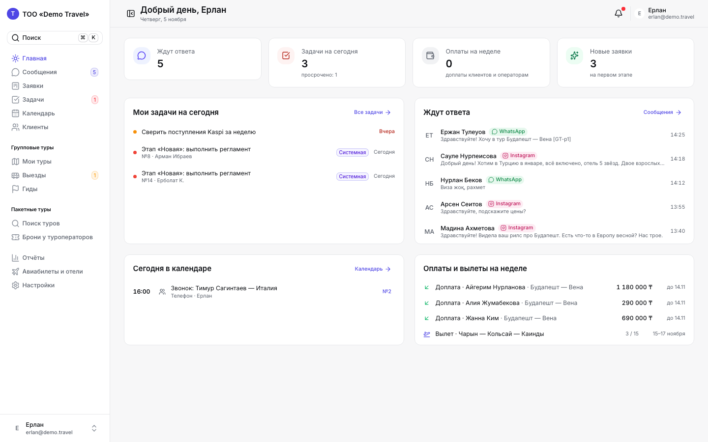
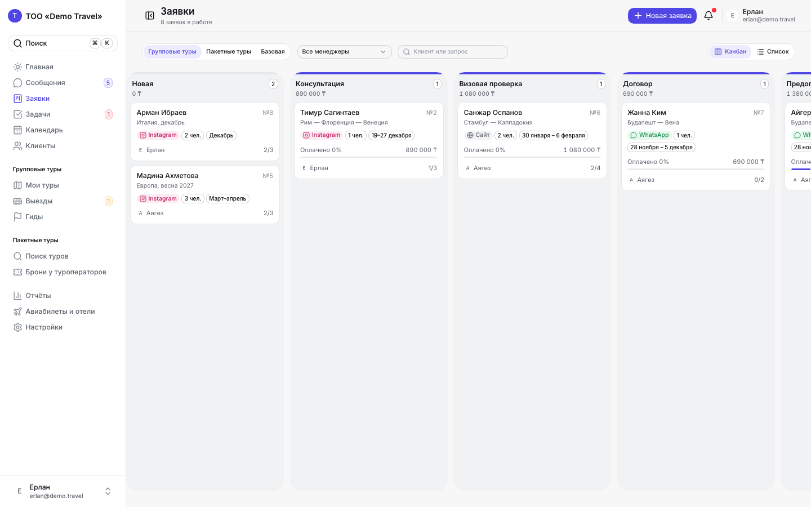
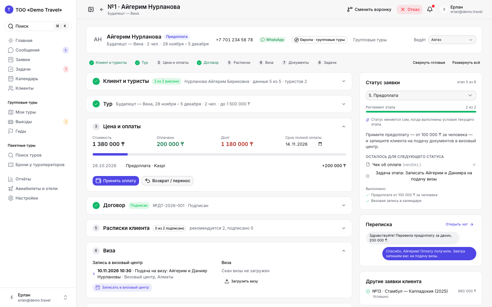
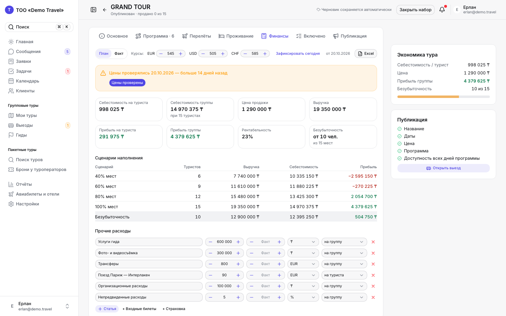
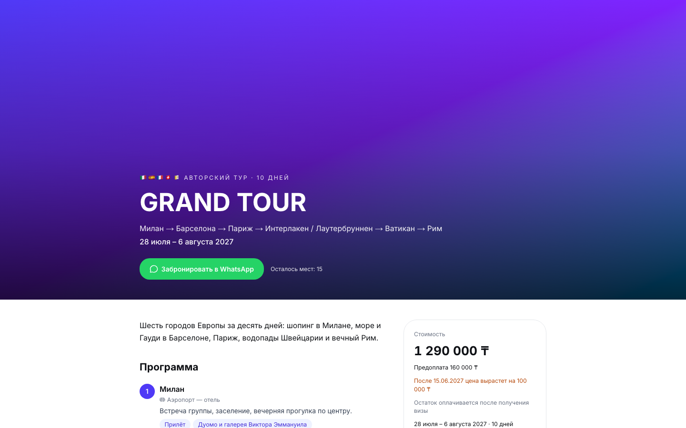

# Tourflow

CRM для турагентств Казахстана: заявки от первого сообщения в WhatsApp до вылета, авторские групповые туры, пакетные туры туроператоров, договоры с электронной подписью, оплаты, задачи, календарь и отчёты.

Nuxt 4 · PostgreSQL 16 · Prisma · Docker.



| Заявки | Страница заявки |
|---|---|
|  |  |
| **Конструктор тура** | **Публичная страница тура** |
|  |  |

Документы: продукт и правила — [`docs/`](docs), исходный пакет передачи — [`docs/HANDOFF.md`](docs/HANDOFF.md), решения по ходу работы — [`docs/DECISIONS.md`](docs/DECISIONS.md), изменения — [`CHANGELOG.md`](CHANGELOG.md), деплой — [`deploy/README.md`](deploy/README.md).

## Быстрый старт (Docker)

Нужен только Docker Desktop.

```bash
cp .env.example .env
# впишите NUXT_APP_SECRET и PII_ENCRYPTION_KEY: openssl rand -base64 32
docker compose up -d --build   # или: make up
make seed                      # демо-данные; миграции применяются сами при старте
```

| Сервис | Адрес |
|---|---|
| Приложение | http://localhost:3000 |
| Почта (Mailpit) | http://localhost:8025 |
| Хранилище файлов (S3, SeaweedFS) | http://localhost:9000 |
| PostgreSQL | localhost:5432, `tourflow` / `tourflow` |

### Демо-логины (пароль `demo1234`)

| Роль | Логин |
|---|---|
| Владелец | `erlan@demo.travel` |
| Менеджер | `ayagoz@demo.travel` |
| Колл-центр | `callcenter@demo.travel` |

Демо-даты сдвигаются к дню запуска сида. Сид **стирает базу** — только для стенда.

## Разработка

Нужны Node 22 и pnpm (pnpm сам скачает Node 22 для проекта через `devEngines`).

```bash
pnpm install
docker compose up -d db s3 gotenberg mailpit   # только инфраструктура
pnpm db:migrate && pnpm db:seed
pnpm dev                                       # http://localhost:3000
```

Проверки: `pnpm lint && pnpm typecheck && pnpm test`, e2e: `pnpm build && pnpm test:e2e` (нужна свежая демо-база).

Горячие клавиши: `N` — новая заявка, `/` или `⌘K` — поиск, `J`/`K` — следующий/предыдущий диалог.

## Архитектура

```
app/          Nuxt-приложение: страницы, компоненты (deal/, task/, tour/, settings/, report/), composables
server/
  api/        REST по ресурсам; права проверяются в каждом эндпоинте (requireAuth)
  services/   сценарии: заявки и автостатус, договоры, выезды, отчёты, распределение
  providers/  внешние сервисы за интерфейсами: messaging, signing, tourSearch, travel, notify, ai (mock по умолчанию)
  jobs/       фоновые задачи на pg-boss: напоминания, мониторинг цен, еженедельный отчёт
  utils/      prisma, изоляция организаций (scopedDb), шифрование ПДн, S3, почта, Excel
shared/       общий для клиента и сервера код: доменная логика (domain/), Zod-схемы, форматирование
prisma/       схема, миграции, демо-данные
tests/        unit (Vitest) и e2e (Playwright)
```

Ключевые правила (`CLAUDE.md`): один менеджер ведёт заявку, статус меняется сам по регламенту, задачи меняют статус только кнопками, клиент ищется по телефону, финансы тура скрыты от туристов, деньги — целые тенге, ИИН и паспорта шифруются, всё пишется в историю.

## Реальные подключения

Без ключей всё работает на mock-провайдерах. WhatsApp Cloud API, Instagram, Telegram, Tourvisor, ЭЦП и распознавание скриншотов включаются переменными в `.env` — пошагово в [`deploy/README.md`](deploy/README.md#6-подключение-реальных-сервисов).

## CI и релизы

- `.github/workflows/ci.yml` — линт, типы, юнит-тесты, сборка, e2e на каждый PR и push в `main`.
- `.github/workflows/docker.yml` — образ `ghcr.io/koishybayt-tech/tourflow` при push в `main` и тегах `v*`.
- Релиз: `git tag v0.1.0 && git push --tags`.
